<p align="center">
  <picture>
    <source media="(prefers-color-scheme: dark)" srcset="docs/assets/logo-dark.svg">
    
  </picture>
</p>

<p align="center">
  <strong>A local control room for <a href="https://github.com/ggml-org/llama.cpp">llama.cpp</a>'s <code>llama-server</code>.</strong><br>
  Launch models, watch every GPU in real time, chat, benchmark, and find the best offload settings for your hardware,<br>
  all from one browser tab served by a single Bun process.
</p>

<p align="center">
  
  
  
  
  
  <a href="LICENSE"></a>
</p>

<p align="center">
  <a href="#features">Features</a> ·
  <a href="#requirements">Requirements</a> ·
  <a href="#installation">Installation</a> ·
  <a href="#configuration">Configuration</a> ·
  <a href="#for-developers">For developers</a>
</p>

<p align="center">
  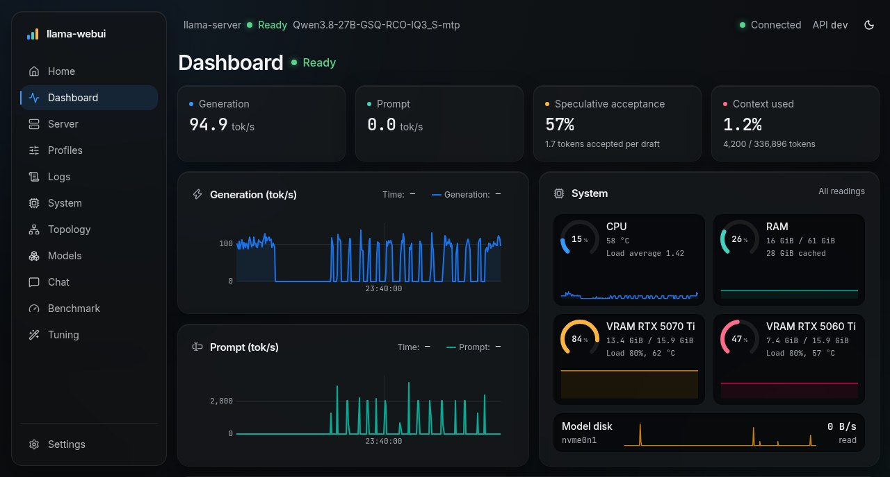
</p>

## Why llama-webui?

`llama-server` is fast and flexible, but running it day to day means juggling long command lines, `nvidia-smi` in
another terminal, and a lot of trial and error to fit a big model across several GPUs. llama-webui wraps all of that in
one dashboard designed for a **single machine you own**:

- **One process, one port.** API, WebSocket and UI are served by Bun on port `7860`. No build step, no database server:
  everything lives in a SQLite file.
- **Mixed hardware.** NVIDIA (NVML), AMD (sysfs) and CPU are first-class, including multi-GPU setups mixing CUDA and
  Vulkan/ROCm devices.
- **Measured, not guessed.** Throughput, VRAM, PCIe traffic, disk reads and DRAM bandwidth come from the real server and
  the real hardware, and tuning recommendations are validated by actual benchmark runs.

## Features

### 🚀 Server and profiles

- **First-run setup checklist**, then a **launch pad** on Home: every profile with its model, quantization, last
  benchmark and estimated memory fit, started (or switched to) in one click.
- Start, stop, restart or switch `llama-server` in one click; states are tracked live (_starting → ready → stopping_,
  crash detection, externally launched servers detected through `/proc`).
- **Profiles** store a model, an optional multimodal projector, a working directory, `llama-server` arguments and
  environment variables. The argument editor has syntax highlighting, **flag autocompletion and inline help** parsed
  from your own `llama-server --help`.
- Import/export profiles as JSON, including a one-click import of existing llama-tui profiles.
- The server page shows the **effective command line**, `/props` info (quantization, context, slots, modalities,
  llama.cpp build) and the latest logs.
- The child process is tied to llama-webui (`setpriv --pdeathsig`), so it never outlives it.

<table>
  <tr>
    <td width="50%">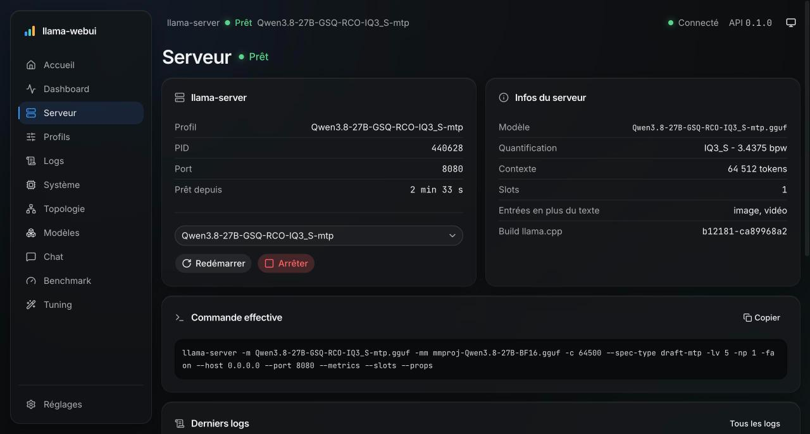<p align="center"><sub><b>Server</b>: status, effective command and <code>/props</code></sub></p></td>
    <td width="50%">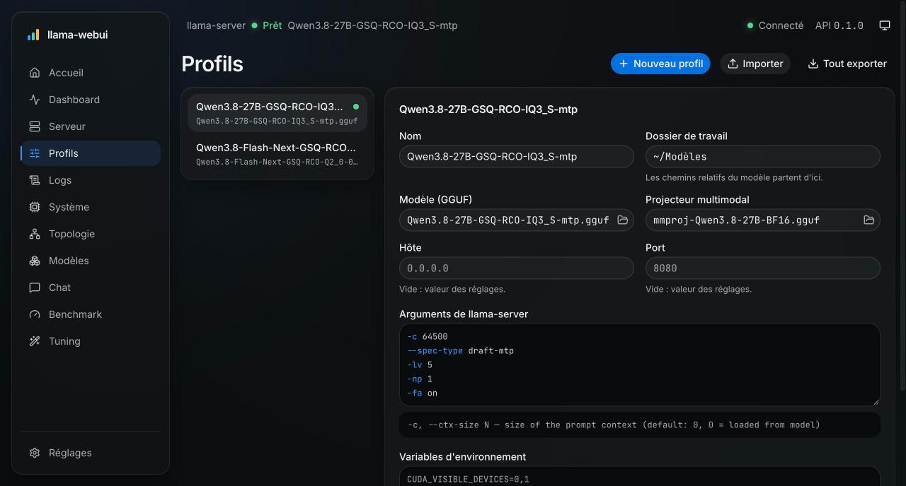<p align="center"><sub><b>Profiles</b>: editor with inline flag help</sub></p></td>
  </tr>
</table>

### 📈 Live monitoring

- **Dashboard**: generation and prompt tokens/s, speculative-decoding acceptance (draft model or MTP), context usage
  per slot, CPU/RAM/VRAM gauges, model disk reads and a rolling throughput chart.
- **System**: one card per GPU with utilization, VRAM, PCIe link and traffic, power, clocks, temperature and
  fans, plus CPU, memory and disk. NVIDIA through NVML (falls back to `nvidia-smi`), AMD through sysfs.
- **Logs**: 10,000-line live ring buffer with level filter, search and auto-follow.

<p align="center">
  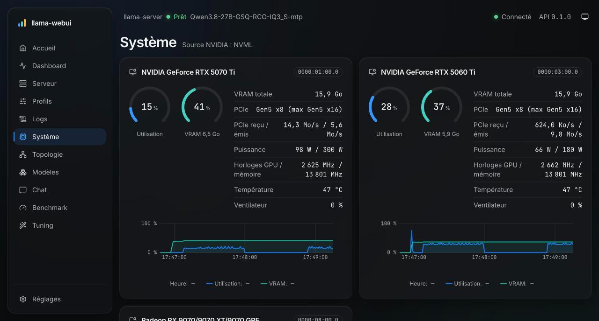
</p>

### 🧭 3D hardware topology

The **Topology** page draws your machine as an interactive 3D scene (react-three-fiber): CPU, memory,
NVMe drives, GPUs and chipset, discovered automatically from sysfs. Streaks flow along each link according to
**measured** PCIe, NVMe and DRAM traffic (DRAM through `perf` on AMD Zen 4/5), with the exact throughput next to it
and an alert when a link nears its capacity. GPUs and memory are tanks filled to the memory in use, and cards show the
current phase (loading, prompt, generation) and **how the model is split across devices**, parsed from
`llama-server`'s startup logs.

<p align="center">
  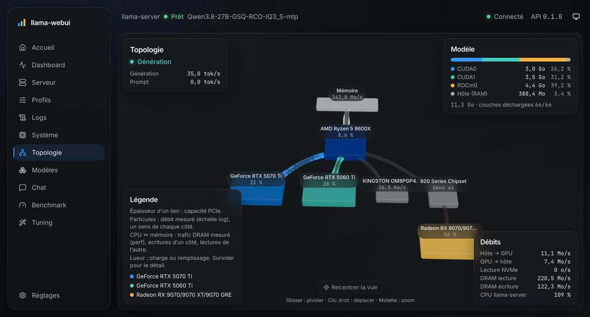
</p>

### 💬 Chat

- Streaming responses with Markdown, GFM tables and syntax-highlighted code blocks (Shiki) with copy buttons.
- Collapsible reasoning for thinking models.
- Per-conversation sampling settings and system prompt, stop and regenerate.
- **Stats under every answer**: time to first token, prompt and generation speed, token count, MTP/draft acceptance.
- Conversations are persisted in SQLite and generation keeps running server-side if you leave the page.

<p align="center">
  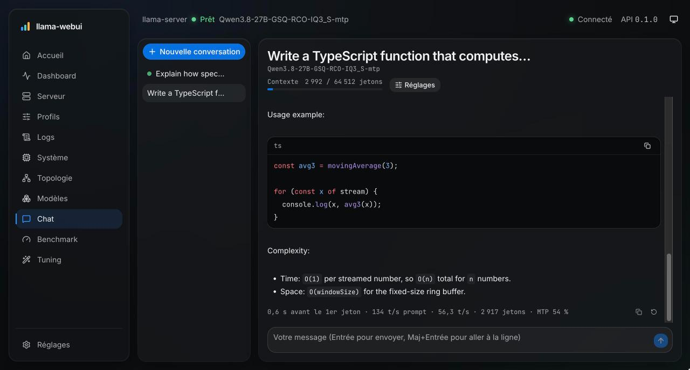
</p>

### 📦 Models

Recursive scan of your models folder with GGUF header metadata: architecture, quantization, size, parameters, layers,
context length and experts (MoE). Split (sharded) models and multimodal projectors are recognized.

Download GGUF models from **Hugging Face** without leaving the app: search the Hub (or paste a repo id or URL), pick a
quantization (shards are grouped, a matching `mmproj` is offered, a badge tells whether it fits in your VRAM) and it lands
in `<models folder>/<org>/<repo>/`. One download at a time, with live progress, sha256 verification, a free-space check,
and automatic resume after a network error or a restart.

<p align="center">
  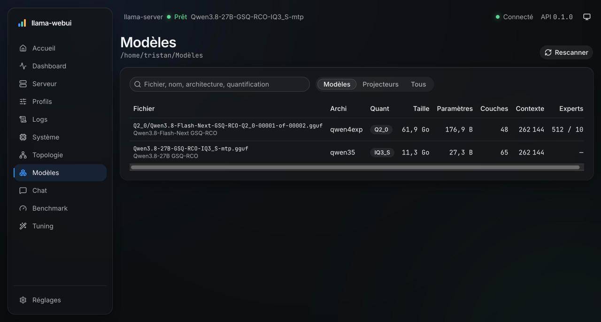
</p>

### ⏱️ Benchmark

- Run **`llama-bench`** (raw llama.cpp speed) or a **real `llama-server`** run (warm-up plus measured completions,
  speculative decoding and the profile's context included, peak VRAM recorded).
- Start from a model and flags or from an existing profile: `-ngl`, `-ncmoe`, `-dev`/`-ts`, `-sm`, `-fa`, `-ctk`/`-ctv`,
  `-ot`, threads, batch sizes…
- Live progress, a filterable history, **side-by-side comparison** with differences highlighted, and **turn any run into
  a profile**.

<p align="center">
  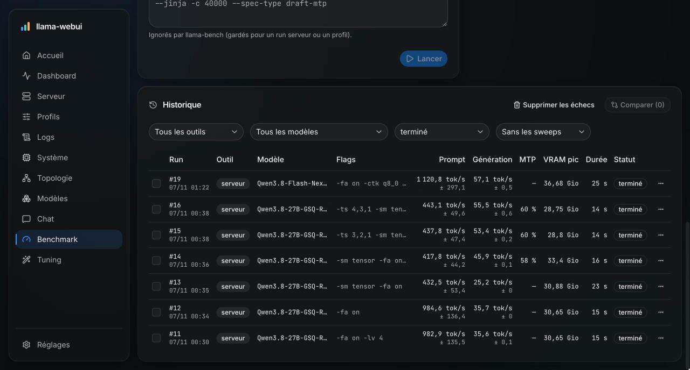
</p>

### 🪄 Tuning and sweeps

- Detects your GPUs, RAM and CPU and **recommends a full set of flags** for a goal: _responsive chat_, _agent & RAG_,
  _max context_, _make the model fit_, or _100 GB model_ (MoE experts in RAM, attention and norms on every GPU).
- Every recommended flag comes with **why**, and a per-device VRAM/RAM estimate tells you what fits, what spills, and
  how much NVMe bandwidth an `mmap` overflow will cost per generated token.
- **Sweeps** explore a search space you define (values per flag, devices, `--override-tensor` patterns): the cartesian
  product is filtered by the estimator, run sequentially with `llama-bench` (resumable after a restart), ranked, and the
  best candidates are **validated with a real server** before becoming a profile.
- A read-only **system checks** panel (NVIDIA persistence mode and power limit, PCIe link, ReBAR, AMD DPM, CPU governor,
  THP, memlock, swappiness, IOMMU, disk speed…) with the command to fix each item.

<p align="center">
  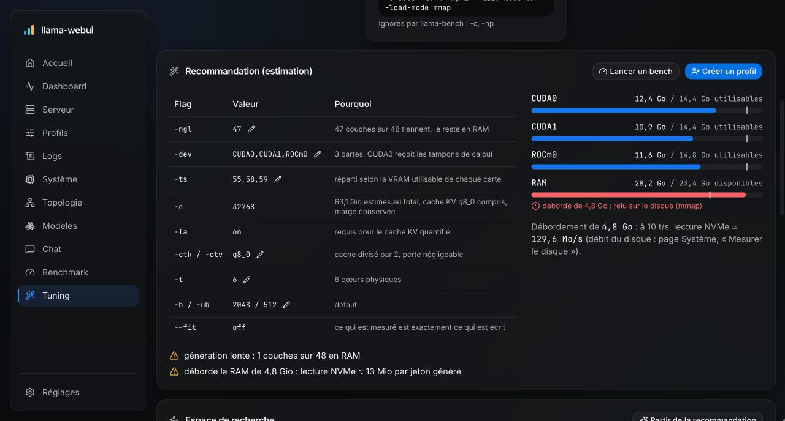
</p>

### 🎨 Polished UI

Light and dark themes (or follow the system), a refined glass look, and real-time updates over a single WebSocket that
reconnects on its own.

<p align="center">
  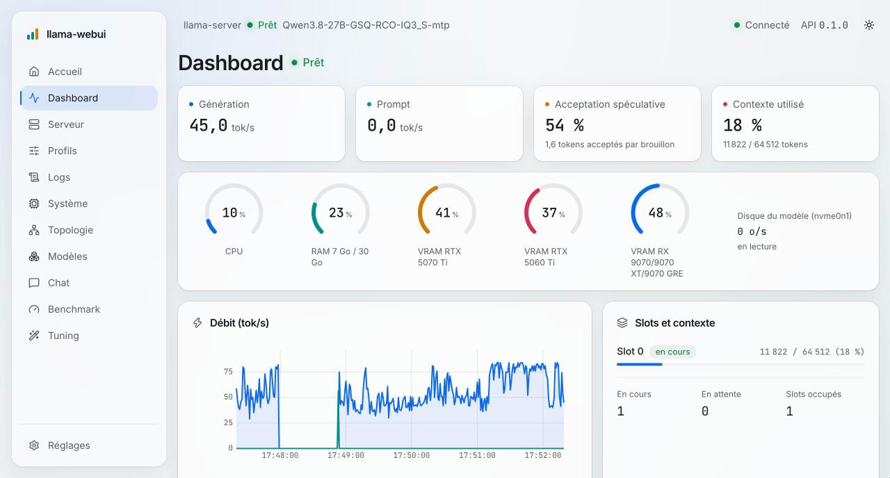
</p>

## Requirements

| Requirement                                                                      | Notes                                                                                                                                                |
| -------------------------------------------------------------------------------- | ---------------------------------------------------------------------------------------------------------------------------------------------------- |
| **Linux**                                                                        | Hardware discovery and telemetry read `/proc` and `/sys`. `setpriv` (util-linux) is used to tie `llama-server` to llama-webui.                       |
| **[Bun](https://bun.com) ≥ 1.4.4**                                               | Only to run from source (the executable includes it). The only runtime needed: no Node.js, no separate build.                                        |
| **[llama.cpp](https://github.com/ggml-org/llama.cpp)** build with `llama-server` | Any backend (CUDA, Vulkan, ROCm, CPU…). Put `llama-bench` next to `llama-server` to enable benchmarks and sweeps.                                    |
| GGUF models                                                                      | In a folder of your choice (set it in Settings).                                                                                                     |
| _Optional_: NVIDIA driver                                                        | GPU telemetry through NVML, falling back to `nvidia-smi`.                                                                                            |
| _Optional_: `amdgpu` driver                                                      | AMD GPU telemetry through sysfs.                                                                                                                     |
| _Optional_: `perf`                                                               | DRAM bandwidth on AMD Zen 4/5. Needs `kernel.perf_event_paranoid ≤ 0` or `setcap cap_perfmon=ep` on `perf`; otherwise CPU activity is shown instead. |

## Installation

llama-webui ships as a **single executable** for Linux (x64 and arm64), Bun runtime and UI included. Download it from
the [latest release](https://github.com/SharkEzz/llama-webui/releases/latest) (`llama-webui-linux-arm64` on ARM):

```bash
mkdir -p ~/.local/bin
curl -fL -o ~/.local/bin/llama-webui \
  https://github.com/SharkEzz/llama-webui/releases/latest/download/llama-webui-linux-x64
chmod +x ~/.local/bin/llama-webui
llama-webui
```

Or run it from source (needs Bun):

```bash
git clone https://github.com/SharkEzz/llama-webui.git
cd llama-webui
bun install
bun run start
```

Then open **<http://127.0.0.1:7860>**. The status bar shows the running version: the release tag or commit hash of the
executable, `dev` from source.

On first launch, Home opens a **setup checklist**: it finds your `llama-server` binary (or asks for its path), checks
the models folder, lists what `llama-bench` and the GPU telemetry can see, and reviews the machine configuration with
the exact commands to run. Only the binary and the models folder are required; you can reopen the checklist later from
**Settings**. Once it is done, Home becomes a **launch pad**: one card per profile, with its model, last benchmark and
memory fit, started in one click.

> [!TIP]
> Not sure which flags to use? Open **Tuning**, pick your model and a goal, and click _Create profile_ from the
> recommendation, or _Run a benchmark_ to measure it first.

## Configuration

Launch options can be passed as flags or environment variables (a flag wins over its variable). `llama-webui --help`
(or `bun run start --help`) lists them.

| Flag                | Environment variable   | Default                                                         |
| ------------------- | ---------------------- | --------------------------------------------------------------- |
| `--host <address>`  | `LLAMA_WEBUI_HOST`     | `127.0.0.1` (`0.0.0.0` opens it to the LAN)                     |
| `--port <port>`     | `LLAMA_WEBUI_PORT`     | `7860`                                                          |
| `--data-dir <path>` | `LLAMA_WEBUI_DATA_DIR` | `$XDG_DATA_HOME/llama-webui`, else `~/.local/share/llama-webui` |

```bash
llama-webui --host 0.0.0.0 --port 8080   # from source: bun run start --host 0.0.0.0 --port 8080
```

Hugging Face downloads use the same token as the `hf` CLI: `HF_TOKEN` if set, otherwise the token saved by
`hf auth login` (`~/.cache/huggingface/token`, or `$HF_HOME/token`). It is only needed for gated or private repos (and
gives higher rate limits); llama-webui never stores it. `HF_ENDPOINT` points to a mirror.

Everything else (binary path, default `llama-server` host and port, models folder, polling interval, history length,
hidden GPUs, collectors, theme) is set from the **Settings** page and stored in the SQLite database inside the data
directory, along with profiles, conversations, benchmark runs and sweeps.

> [!WARNING]
> llama-webui has **no authentication**: whoever can reach it can start processes on your machine. It listens on
> `127.0.0.1` by default. The API rejects cross-site requests and DNS-rebinding attempts, but only use `--host 0.0.0.0`
> on a network you trust, and never expose it to the internet.

## For developers

> [!NOTE]
> This is the short version. The full developer documentation is on the website:
> [sharkezz.github.io/llama-webui/developers](https://sharkezz.github.io/llama-webui/developers/).

### Getting started

```bash
bun install
bun run dev        # bun --hot: HMR for the UI, live reload for the server
bun run compile    # standalone executable in dist/llama-webui (--target bun-linux-arm64)
bun run release 0.2.0  # set every package.json version, merge, then tag v0.2.0
bun run check      # type check (server, shared and web)
bun run test       # every test (bun test)
bun run lint       # Biome: format + lint + import order (read-only)
bun run lint:fix   # apply Biome's safe fixes
```

### Architecture

llama-webui is **one Bun process** that serves the UI, a REST API and a WebSocket, and drives `llama-server` as a
child process.

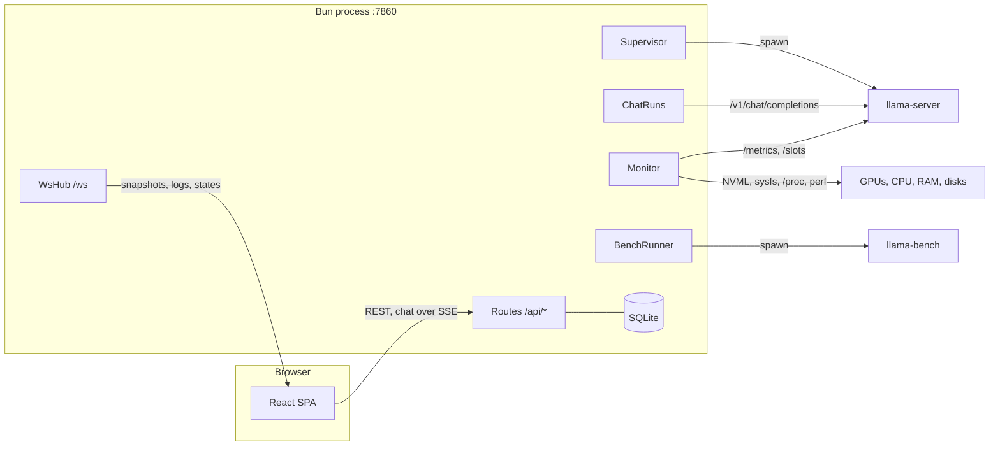

| Piece                                                 | Role                                                                                                                                                                                                                                                                                               |
| ----------------------------------------------------- | -------------------------------------------------------------------------------------------------------------------------------------------------------------------------------------------------------------------------------------------------------------------------------------------------- |
| `server/index.ts`                                     | Entry point: opens SQLite, builds the services below and wires their events to the WebSocket, then starts `Bun.serve` (`server/app.ts`, one module per domain in `server/routes/`).                                                                                                                |
| **Supervisor** (`server/supervisor/`)                 | Owns the single managed `llama-server`: builds its argv from a profile (adding `--host`, `--port`, `--metrics`, `--slots`, `--props`), tracks its state (`idle`, `starting`, `ready`, `stopping`, `crashed`, or `external` for a server it did not launch) and pipes its output into the log ring. |
| **Monitor** (`server/monitor/`, `server/collectors/`) | Polls every collector once per tick (1 s by default) and merges the results into a `Snapshot`: `llama-server` `/metrics` and `/slots`, NVML through `bun:ffi` in a worker (`nvidia-smi` as a fallback), AMD sysfs, `/proc`, disks and `perf`. History is kept in RAM only.                         |
| **WsHub** (`server/ws/`)                              | Pushes typed messages (`WsMessage` in `shared/src/ws.ts`): `snapshot`, `log`, `server-state`, `placement`, `bench-*`, `sweep-*`. The client reconnects with backoff and re-reads the current state over REST.                                                                                      |
| **ChatRuns** (`server/chat/`)                         | Relays the OpenAI-compatible stream of `llama-server` as SSE and persists messages and stats. A generation is owned by the server, not by the HTTP request: leaving the page does not stop it.                                                                                                     |
| **BenchRunner** (`server/bench/`)                     | Runs one benchmark at a time (`llama-bench -o json` or a temporary `llama-server`). The **bench gate** stops the managed server for the duration and restarts it afterwards. Sweeps are a queue stored in SQLite, resumed on startup.                                                              |
| **Tuning** (`server/tuning/`)                         | Memory estimator (GGUF header + devices), presets, sweep search space and system checks.                                                                                                                                                                                                           |
| **SQLite** (`server/db/`)                             | `bun:sqlite`, migrations in `migrations.ts`, one repository per table: settings, profiles, conversations, benchmark runs, sweeps. Metrics and logs are never persisted.                                                                                                                            |
| `shared/`                                             | Types, zod schemas and pure functions (parsers, phase, flags) used by both sides.                                                                                                                                                                                                                  |
| `web/`                                                | React 19 SPA. One folder per page in `web/src/features/`, lazy-loaded by the router; API clients and zustand stores per domain in `web/src/lib/`; shared glass components in `web/src/components/glass/`.                                                                                          |

Every `/api/*` route goes through `guarded()` (`server/http.ts`), which applies the checks of `server/security.ts`
(Host header, Origin, JSON-only writes) and turns errors into JSON responses.

### Dev vs production

- `bun run dev` uses the HTML import of `Bun.serve` (`web/index.html`): HMR, a single bundle.
- `bun run start` (`NODE_ENV=production`) bundles the front end **in memory at startup** with `Bun.build`, split per
  page (`server/routes/web.ts`). There is no build step and no `dist/` folder. A Bun plugin added to `bunfig.toml` must
  also be added to `webPlugins()` there.
- `bun run compile` (`scripts/compile.ts`) builds the standalone executable: the same options bundle the HTML import at
  compile time (split per page, embedded); it always runs in production and reports `git describe` as its version
  (`dev` from source). `.github/workflows/release.yml` attaches the x64 and arm64 executables to the release of every
  `v*` tag, which must match the version of every `package.json` (`bun run release <version>`, merged first).

> [!IMPORTANT]
> **Hot reload and long-lived state.** The supervisor, the log ring, the monitor and the bench gate live on
> `globalThis` (`server/runtime.ts`) so that saving a file does not kill the loaded model. Changes to
> `server/supervisor/supervisor.ts`, `server/logs/buffer.ts`, `server/bench/gate.ts`, `server/monitor/**` (except `placement.ts`),
> `server/collectors/**` or `server/runtime.ts` are therefore **not** picked up by `bun --hot`: stop and restart
> `bun run dev`. For the same reason, test supervisor errors by `name`, not with `instanceof`. A file created under
> `web/src/` while `bun run dev` is running may also require a restart.

### Conventions

- Code comments, UI strings, commit messages and pull requests are in **English**.
- Before committing or opening a PR, `bun run lint`, `bun run check` and `bun run test` must all pass, with zero Biome
  errors or warnings. Do not disable or downgrade a rule; use a targeted `// biome-ignore` with a reason for a genuine
  false positive.
- `web/src/components/ui/` is generated by shadcn and left untouched (ignored by Biome).
- Tests cover pure logic (parsers, estimator, sweep space…) with real captured outputs in `testdata/`.

### Tech stack

[Bun](https://bun.com) (runtime, HTTP/WebSocket server, bundler, SQLite, tests) ·
[React 19](https://react.dev) · [React Router](https://reactrouter.com) · [Tailwind CSS 4](https://tailwindcss.com) ·
[shadcn/ui](https://ui.shadcn.com) on [Base UI](https://base-ui.com) · [uPlot](https://github.com/leeoniya/uPlot) ·
[react-three-fiber](https://r3f.docs.pmnd.rs) · [Shiki](https://shiki.style) · [Zustand](https://zustand.docs.pmnd.rs) ·
[Zod](https://zod.dev) · [Biome](https://biomejs.dev)

## License

[MIT](LICENSE) © SharkEzz
